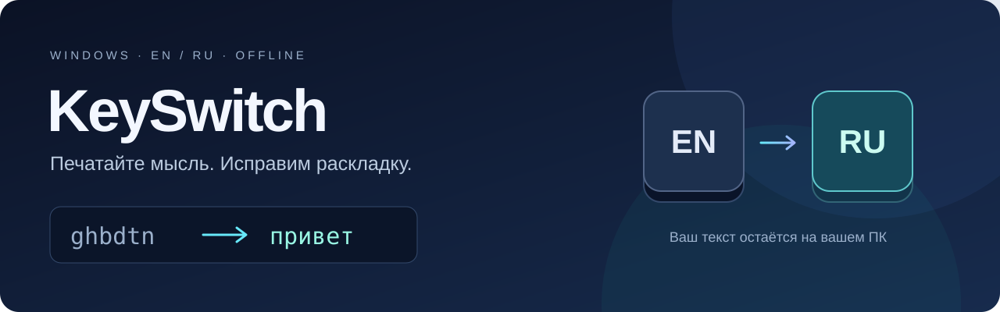

<div align="center">



# KeySwitch · автоматическая смена раскладки EN ↔ RU

**Печатайте мысль. KeySwitch исправит раскладку.**

Локальный переключатель русской и английской раскладки для Windows 11.
Исправляет слова, набранные не на том языке, и работает из системного трея.

[](#запуск)
[](#сборка-и-воспроизведение-проверок)
[](LICENSE)
[](https://github.com/oover120/KeySwitch-GPT/releases/latest)

[**Скачать**](https://github.com/oover120/KeySwitch-GPT/releases/latest) · [Возможности](#возможности) · [Совместимость](#совместимость-с-защитой-клавиатуры-eset) · [English](README.en.md) · [Сообщить об ошибке](https://github.com/oover120/KeySwitch-GPT/issues)

</div>

## Из неверной раскладки — в нужные слова

Наберите слово и нажмите пробел. Если ошибка уверенно распознана, KeySwitch исправит слово и переключит язык активного окна.

| Набрано | Результат |
| :--- | :--- |
| `ghbdtn` | `привет` |
| `руддщ` | `hello` |
| `[jhjij` | `хорошо` |
| `ghbdtn,` | `привет,` |

Правильные словарные слова остаются на месте. Неоднозначные и слишком короткие слова могут быть пропущены. Последнее исправление можно отменить.

## Возможности

**Новое в 1.0.5:** настраиваемый приоритет русского при неоднозначных словах и проверка новых версий на GitHub. В версии 1.0.3 добавлены выбор исключений через обзор, исправление устаревшего пути автозапуска и новая иконка.

Приоритет русского также исправляет некоторые короткие слова, например `gj` → `по`. Короткие слова и сокращения неоднозначны: возможны ложные замены, поэтому настройку можно отключить в разделе «Общие».

| Возможность | Что делает |
| :--- | :--- |
| **Автоматическая смена раскладки** | Проверяет слово на пробеле, Enter или Tab; поддерживает EN US и RU ЙЦУКЕН. |
| **Исправление выделенного текста** | Конвертирует выделение по горячей клавише. |
| **Быстрая отмена** | Возвращает последнее исправление через Pause/Break или двойной Shift, пока позиция ввода не изменилась. |
| **Исключения и обучение** | Настройки для программ, папок и слов; локальное обучение по действиям пользователя. |
| **Дополнительные исправления** | Опечатки, две заглавные в начале слова и ёфикатор для однозначных форм. |
| **Работа в трее** | Настройки WPF, темы оформления, горячие клавиши и необязательные звуки. |
| **Локальная обработка** | Встроенные языковые модели; для работы не нужны интернет и аккаунт. |

Открытая альтернатива Punto Switcher для переключения EN/RU. Это самостоятельный проект, не связанный с разработчиками Punto Switcher.

Название репозитория **KeySwitch-GPT** отличает эту реализацию KeySwitch. Программа не обращается к GPT или другим облачным API.

## Запуск

- Скачайте [последний релиз](https://github.com/oover120/KeySwitch-GPT/releases/latest): установщик **`KeySwitch-Setup-1.0.5-x64.exe`** или переносной **`KeySwitch-1.0.5-win-x64.zip`**. ZIP распакуйте целиком и запустите `KeySwitch.exe`.
- Требования: **Windows 11 x64**. Готовая сборка включает .NET Runtime.
- Готовая программа: `artifacts/publish/KeySwitch.exe`. .NET устанавливать не нужно.
- Установщик: `artifacts/installer/KeySwitch-Setup-1.0.5-x64.exe`.
- После запуска откройте меню значка RU/EN в трее. Двойной щелчок открывает настройки.
- `KeySwitch.exe --settings` открывает настройки, в том числе у уже работающего экземпляра.
- `--smoke` запускает безопасную трёхсекундную проверку и завершает приложение; `--preview --settings` открывает интерфейс с отключённой автокоррекцией.
- Автозапуск по умолчанию выключен. Включается из трея или настроек. Вариант с правами администратора доступен в настройках и вызывает UAC только по вашему действию.

> **ESET:** включённая «Защита клавиатуры» в защищённом браузере несовместима с текущим механизмом KeySwitch. Это подтверждено ручным контрольным тестом. Программа не изменяет настройки антивируса. Подробности — в разделе совместимости ниже.

## Работа с текстом

Напечатайте `ghbdtn` в английской раскладке и нажмите пробел: KeySwitch заменит слово на `привет` и запросит русскую раскладку у активного окна. Клавиши квадратных скобок, точки с запятой, апострофа, запятой, точки и обратной кавычки учитываются как потенциальные русские буквы; пунктуация в конце анализируется отдельно.

| Действие | По умолчанию |
|---|---|
| Отмена последней замены | Pause / Break или два коротких тапа Shift за 400 мс |
| Конвертация текущего/последнего слова | Pause / Break, если нет доступной отмены |
| Конвертация выделения | Ctrl+Shift+Space |
| Пауза автоматики | Ctrl+Shift+F12 |
| Одиночный Shift меняет язык | Выключено; опция в настройках |

Горячие клавиши выделения и паузы редактируются. Поддерживаются Ctrl+Shift, Ctrl+Alt и Ctrl+Win; Alt+Shift остаётся Windows.

Отмена работает, пока курсор непосредственно после исправления. Печатный символ, редактирование, перемещение курсора, мышь или смена фокуса отменяют этот токен. После Enter/Tab отмена и изменение предыдущего слова запрещены: приложение уже могло отправить сообщение или переместить фокус. Shift+Enter и Shift+Tab пропускаются без коррекции, чтобы сохранить действие исходного сочетания.

Конвертация выделения сохраняет форматы буфера обмена до Ctrl+C и восстанавливает их после Ctrl+V. Неподдерживаемый формат приводит к отказу до захвата буфера; новые изменения буфера пользователем или менеджером обмена не затираются. Приложения с нестандартной/отложенной вставкой требуют ручной проверки; универсального подтверждения завершения вставки Win32 не предоставляет.

## Настройки и приватность

Данные находятся в `%APPDATA%\KeySwitch\settings.json`:

- параметры, списки программ/папок и направленные исключения слов;
- редактируемые замены опечаток и однозначные формы с ё;
- только явно подтверждённые слова обучения и счётчики принятия/отмены, максимум 2000 записей.

Нет телеметрии, журнала нажатий или истории документов. При включённой проверке обновлений программа обращается к GitHub при запуске; проверку можно отключить в общих настройках или запустить вручную из трея. GitHub получает обычные технические данные запроса, включая IP-адрес. Набранный текст и настройки не отправляются. Слово в буфере ограничено 64 символами и живёт только в памяти. В UI Automation читаются признаки фокуса/пароля, не значения или текст документа. Файл сохраняется атомарно; ошибка чтения выключает автоматику и оставляет исходный файл.

После трёх отмен слово становится локальным исключением. Ручная конвертация учитывается как позитивный пример. Одиночные буквы, 100 самых частотных слов и строки, похожие на пароли, не попадают в обучение.

Для процессов доступны «Выключено», «Только вручную» и «Полностью». Редакторы кода, терминалы и RDP-клиенты по умолчанию работают только вручную. Автоматически исключаются exe из списка игр, папок `Games` и окна, для которых Windows сообщает эксклюзивный полноэкранный режим. Chrome, Edge, Firefox и другие браузеры из списка пропускают автоматическое исключение игр. Явные правила программ по-прежнему действуют.

Явное `IsPassword=true` и чужое повышенное окно блокируют обработку. Проверка UI Automation асинхронна, ограничена 50 мс и кэшируется до смены фокуса. Ошибка, неопределённый результат и таймаут разрешают обычную обработку после окончания проверки. Для смешанных строк длиной >6 со строчными, заглавными и цифрами или знаками действует дополнительная эвристика пароля.

Технический журнал `%APPDATA%\KeySwitch\debug.jsonl` всегда содержит INFO-записи `word` для завершённых слов, `buffer-reset` для сбросов и `ignored` для пропущенных нажатий. `ignored` ограничен одной записью в секунду. Журнал хранит имя exe, класс поля, результат UIA, длины, оценки детектора, решение и результат Win32. Текст слова, заголовок окна, URL и пути процессов не записываются. `null` означает, что этап не запускался. «Настройки → Общие» и `KeySwitch.exe --debug` добавляют подробные DEBUG-записи фокуса. `tools/InputProbe/browser.html` содержит локальные поля для проверки, включая поле с меняющимся заголовком страницы.

«Опечатки», ёфикатор, звуки, одиночный Shift и раннее срабатывание выключены по умолчанию. Исправление двух заглавных включено. WAV выбираются пользователем; громкость не меняет системный микшер.

## Сборка и воспроизведение проверок

Нужен .NET SDK 8.0.403+ из ветки 8.0, Windows Desktop targeting pack и доступ к NuGet при первом восстановлении. SDK закреплён в `global.json`. Языковые модели уже находятся в репозитории; сборка их не скачивает.

```powershell
git clone https://github.com/oover120/KeySwitch-GPT.git
cd KeySwitch-GPT
dotnet build KeySwitch.sln -c Release
dotnet test tests/KeySwitch.Tests -c Release
dotnet run --project tools/Evaluate -c Release
dotnet run --project tools/Evaluate -c Release -- --holdout
dotnet publish src/KeySwitch.App -c Release -r win-x64 --self-contained true -o artifacts/publish -p:DebugType=None
```

Evaluate возвращает код 2, если recall <98% или false positive rate >0.5% хотя бы для одного языка. Обычный запуск использует 10 000 первых словарных записей; `--holdout` — все алфавитные словоформы длиной ≥3 из UD r2.15 test. Дополнительно выводится token-weighted recall. `--errors` показывает примеры ошибок **открытого корпуса**, не пользовательского ввода.

Подготовка языковых ресурсов (Python 3.10+, интернет только при выполнении этого инструмента):

```powershell
python tools/DataPrep/prepare.py
```

150 000 словоформ каждого языка — FrequencyWords/OpenSubtitles; символьные 3–4-граммы — train-разделы UD. `assets/sources.json` содержит URL и SHA-256 скачанных исходников. UTF-8 словари хранятся в сортированном бинарном пуле, модели встроены в exe с gzip. Производные модели и списки — CC BY-SA 4.0; код приложения — MIT. См. `licenses/ATTRIBUTION.md`.

Сборка установщика Inno Setup:

```powershell
# Необязательно: получить подписанный официальный переносной компилятор в artifacts/tooling.
./tools/Get-InnoSetup.ps1
./artifacts/tooling/inno/ISCC.exe installer/KeySwitch.iss
# Либо используйте установленный ISCC.exe.
```

Полный воспроизводимый проход: `./tools/Build.ps1`. Он сохраняет отчёты в `artifacts/reports`, публикует программу и при наличии ISCC собирает установщик. `tools/InputProbe` — отдельное временное WPF-поле для ручных тестов, оно не сохраняет ввод на диск.

## Проверенные результаты и границы

На этапе разработки Release проходит xUnit, сборку и smoke-запуск. Итоговые численные отчёты находятся в `artifacts/reports`. Внешний test-раздел не включался в обучение моделей, но его метрики использовались при настройке порогов; это регрессионная оценка, а не независимая слепая проверка. Короткие слова до трёх букв, цифры, смешанные строки и отдельные неоднозначные сокращения намеренно пропускаются.

Получено на UD test: EN 98.63% верных переключений, 0.047% ложных; RU 98.16% и 0.081% соответственно. Эти цифры не гарантируют такую же точность в любом приложении и жанре. Измерение p95 в Evaluate относится только к детектору, не к задержке появления текста в чужом приложении.

Предварительное измерение self-contained приложения в трее: приватная память около 79 МБ, рабочий набор около 87 МБ. Цель ≤80 МБ по рабочему набору пока не подтверждена. Открытие WPF-настроек увеличивает расход. Реальная задержка ≤100 мс и совместимость всех приложений ниже требуют ручных проверок.

Приложение не может гарантировать ввод в RDP/VM, exclusive fullscreen, защищённые рабочие столы, нестандартные редакторы, поля без корректного UI Automation и приложения с собственной обработкой раскладки. Поддерживаются только EN US и стандартная RU; умляуты/другие раскладки пока не зарегистрированы. Код, искусственные языки, транслитерация и аббревиатуры неоднозначны. Ошибка UIPI может выглядеть как обычный отказ SendInput; в трее есть индикатор повышенного окна.

## Ручной чек-лист перед выпуском

### Совместимость с защитой клавиатуры ESET

В ESET Smart Security Premium 20 опция **«Защита клавиатуры»** скрывает ввод в защищённом браузере от других приложений ([документация ESET](https://help.eset.com/essp/20/en-US/idh_config_sb.html)). Пользователь подтвердил: при отключении этой опции автопереключение работает, после повторного включения перестаёт работать. Текущий механизм KeySwitch на глобальном клавиатурном хуке несовместим с этим режимом.

В таком случае лог может показывать накопленную длину, но отказ детектора `no-plausible-alternative` или `identifier-like`. Одна такая запись не доказывает конфликт с ESET. Изменение порога детектора не решает проблему скрытого ввода. KeySwitch не меняет параметры ESET автоматически; возможность отдельного исключения для него не подтверждена. Отключение защиты клавиатуры уменьшает защиту браузерного ввода от перехвата, поэтому это не рекомендуется как автоматическое исправление.

### Проверки

Неотмеченное означает **не проверено**, а не «прошло». Во время разработки проверены отображение общих настроек и исключений в тёмной теме; дальнейшее управление окнами было остановлено пользователем нажатием Escape.

- [x] Release: сборка, xUnit, запуск трея/настроек и завершение smoke без сбоя.
- [x] Корпусная оценка отдельно от модели, проверка порогов и кодов завершения.
- [x] WPF: читаемость тёмной темы общих настроек и исключений; скругления окна.
- [ ] Блокнот Windows 11: `ghbdtn`, `[jhjij`, `xnj,`, `ghbdtn,`, регистр, CapsLock, пробел/Enter/Tab.
- [ ] Chrome / Edge / Firefox: обычное поле, contenteditable, поиск, смена вкладки.
- [ ] Word: текст, таблица, автозамены Word, Undo после замены.
- [ ] Telegram / Slack / Discord: поле сообщения, обычный Enter, Shift+Enter, отсутствие двойного разделителя.
- [ ] Терминал: режим только вручную, отсутствие автоматических изменений команды.
- [ ] Игра / fullscreen / папка Games: автоматика отключена, явное правило работает.
- [ ] Пароль: IsPassword, переход фокуса обычное поле → пароль; отсутствие обучения/исправлений.
- [ ] Повышенное окно: индикатор ограничения UIPI; отдельно тест с повышенным KeySwitch.
- [ ] Быстрый набор во время замены: порядок, удержание/отпускание Shift/Ctrl, отсутствие потерь/повторов.
- [ ] Отмена Pause и двойным Shift; три отмены создают исключение, позитивное обучение действует.
- [ ] Выделение: текст, HTML/RTF, изображение/файлы в исходном буфере, занятый буфер, менеджер обмена.
- [ ] Светлая тема, клавиатурный фокус, 125/150/200% DPI, несколько мониторов.
- [ ] Звуки WAV, ёфикатор, правила опечаток, одиночный Shift, ранний режим.
- [ ] Установка/обновление/удаление на чистой Windows 11; автозапуск HKCU и задача администратора.
- [ ] Блокировка/разблокировка и быстрое переключение пользователей.
- [ ] p95 от разделителя до видимого текста ≤100 мс; простой ≈0% CPU; рабочий набор ≤80 МБ.

Порядок модулей и инварианты: `ARCHITECTURE.md`; решения и лицензирование: `DECISIONS.md`; журнал фактических проверок: `DEVLOG.md`.

## Обратная связь и лицензии

[Сообщить об ошибке](https://github.com/oover120/KeySwitch-GPT/issues): укажите версию KeySwitch, приложение и шаги воспроизведения. Прикладывайте только необходимые технические строки журнала. Не публикуйте `settings.json` с личными словами обучения.

Код — [MIT](LICENSE). Производные языковые модели и корпусные данные — **CC BY-SA 4.0**, с отдельной [атрибуцией](licenses/ATTRIBUTION.md).

**Для поиска:** автоматический переключатель раскладки, исправление неверной раскладки, русский / английский, Windows keyboard layout switcher, offline typing correction.
